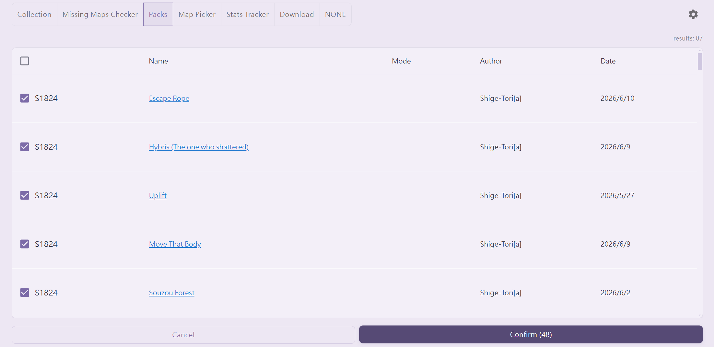
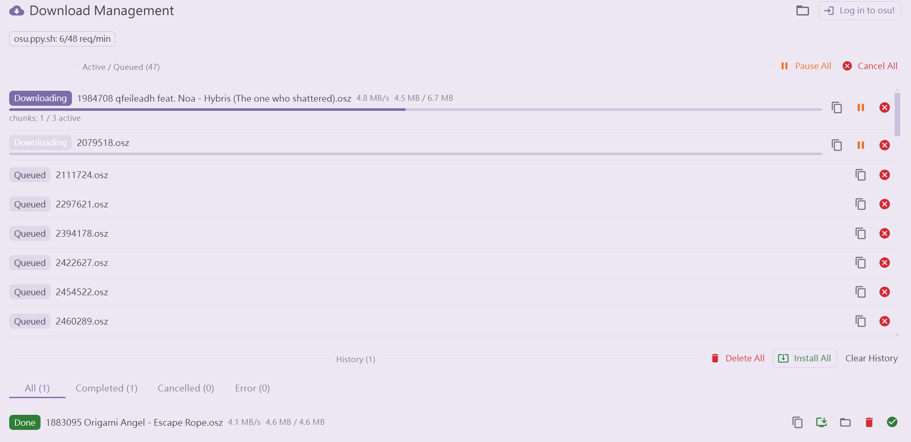
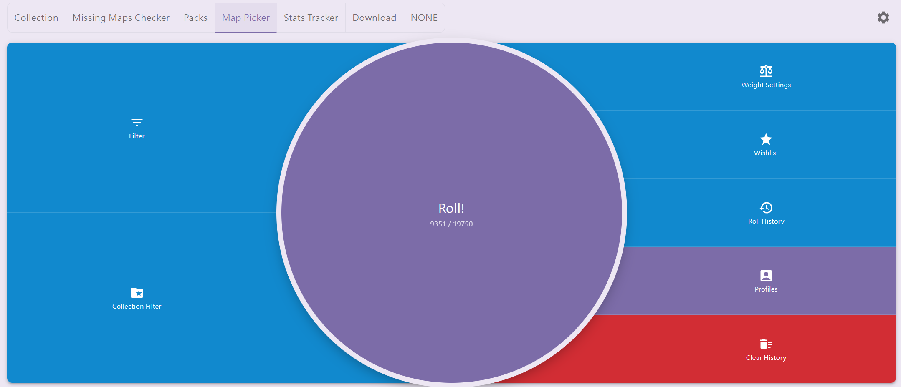
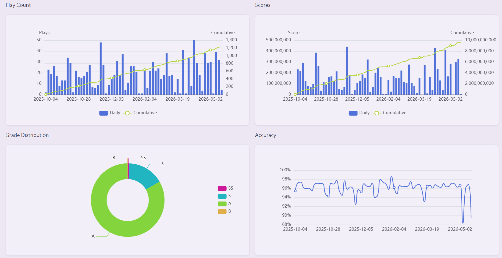

# olSync

## 簡介

**olSync** 是一個基於 Electron 的桌面應用程式，最初設計用於在 osu!stable 和 osu!lazer 兩個客戶端之間同步遊戲資料。

## 功能

* 收藏夾
  * 合併 (Merge): 將 osu!stable 與 osu!lazer 的收藏列表單向合併輸出至 osu!stable。
  * 同步 (Sync): 以收藏夾名稱雙向同步其資料。

* 成績恢復
  * 基於 osu! API v2 取得線上成績記錄
  * 基於本地成績資料

* 圖包下載
  * 基於 osu! API v2 取得圖譜包
    * 僅獲取特定類型圖譜包 / 指定時間內 / 特定遊戲模式
    * 基於本地成績資料進行差異下載，可快速篩選未載譜面
  

* 下載管理器 (Download Manager)
  * 內建下載佇列，支援分塊下載與斷點續傳
  * 內部登入與速率限制
  

* 選圖器 (Map Picker)
  * 可透過篩選及比重設定來隨機選圖 (僅讀取本地地圖集)
  * 成績列表顯示 PP 及各分項數值（aim / speed / accuracy），基於 `rosu-pp-js` 本地計算
  

* 統計 (Statistics)
  * 基於本地成績資料分析遊玩歷史
  * 以圖表呈現每日遊玩次數、分數、命中率及評價分布趨勢
  * 支援多用戶切換，並自動記憶上次瀏覽的用戶
  * 可依日期範圍篩選遊玩紀錄
  

* 多語系 (i18n)
  * 繁體中文 (zh-TW)
  * 英文 (en-US)
  * 日文 (ja-JP)

## 使用方式

點擊齒輪設定 osu!stable 的資料夾與/或 osu!lazer 的 `client.realm` 路徑。

部分功能需求 `osu! API` 權限, 你必須至 [osu!web 設定](https://osu.ppy.sh/home/account/edit#oauth) 中生成一個 `OAuth 應用程式` 並將 `Client ID` 與 `Client Secert` 填寫至齒輪設定當中!

> [!CAUTION]
> `Client ID` 與 `Client Secert` 為敏感資訊, 他們將會明碼儲存於 `config.json` 當中 (通常位於olsync資料夾中的data資料夾裡面)
> 請切記不要隨意分享它們!

## 資料與備份

* 應用設定與快取位於 `{APP_PATH}/data/`
* 收藏同步/合併備份位於 `{APP_PATH}/backup_data/cs/<timestamp>/`

## 開發

### 技術堆疊

* **Electron** 35.x | **React** 19.x | **TypeScript** 5.8
* **MUI** v9 | **MobX** 6.x 狀態管理
* **Biome** 2.x (Lint / Format) | **Webpack** 5.x
* **echarts** 6.x (圖表) | **rosu-pp-js** (PP 計算) | **realm** 12.x (Lazer DB)

### 安裝依賴

```bash
npm install
```

### 開發模式

```bash
npm run dev
```

### 建置應用程式

```bash
npm run build:prod
npm run dist:win
```

### 簽署建置

```bash
npm run gen-keys              # 首次產生 RSA 金鑰
npm run dist:win:signed       # 建置並簽署 manifest
```

### 自動更新 (GitHub Releases)

更新流程由主程序 (`src/entrypoint/js/updater`) 完全掌控，渲染層僅能觸發/監聽狀態，無法指定下載來源或路徑。

共用邏輯（canonical JSON、SHA-256、RSA 簽名、路徑白名單、增量補丁等）集中於 `src/updater-core`，並同時提供給主程序與 `scripts/generate-release.ts` 使用。安裝階段會透過 `updaterWorker.js` 以獨立的 Node/Electron 程序執行，主程序在啟動輔助程序後安全退出，避免 app.asar 被鎖定。

## 系統需求

* Windows 10 或更新版本
* Node.js 18.x 或更新版本
* osu!stable 和/或 osu!lazer 客戶端

## License

[GPL-3.0-or-later](LICENSE)
